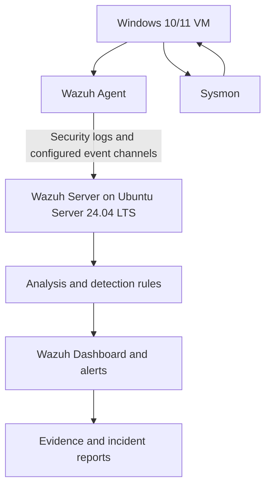

# Windows Security Monitoring and Brute-Force Detection Using Wazuh

> A small, lab-based Security Operations Center (SOC) project for monitoring a Windows endpoint, detecting simulated failed logons, monitoring file integrity, and reviewing process-creation telemetry.

## Project Overview

This project demonstrates a basic security monitoring workflow using **Wazuh**, **Windows Security Event Logs**, and **Sysmon**. A Windows virtual machine generates test events; the Wazuh agent forwards relevant telemetry to a Wazuh server hosted on **Ubuntu Server 24.04 LTS**. Alerts and evidence are reviewed and documented.

**Scope:** Controlled testing in virtual machines owned or authorized by the project team. Brute-force activity is simulated through repeated failed logons against a test account; no real third-party systems are targeted.

## Objectives

- Deploy a Wazuh server on Ubuntu Server 24.04 LTS.
- Enroll a Windows endpoint with the Wazuh agent.
- Collect Windows security events and Sysmon telemetry.
- Review failed-logon event **4625** and the applicable Wazuh alert/rule.
- Implement and validate a custom detection rule (**100100**) for five failed logons within 60 seconds.
- Test File Integrity Monitoring (FIM) for file creation, modification, and deletion.
- Validate process-creation telemetry for Notepad using Sysmon event **ID 1**.
- Produce evidence-based incident reports and reproducible setup documentation.

## Architecture



## Lab Components

| Component | Purpose |
|---|---|
| VirtualBox | Hosts the virtual machines |
| Ubuntu Server 24.04 LTS | Wazuh server |
| Windows 10/11 | Monitored endpoint |
| Wazuh Agent | Forwards configured endpoint telemetry |
| Sysmon | Provides detailed process and system telemetry |
| Wazuh Dashboard | Alert review and investigation |
| GitHub | Version control, documentation, and sanitized evidence |

Suggested VM resources (adjust to host capacity):
- **Wazuh server:** 4 vCPU, 8 GB RAM, 50 GB disk
- **Windows endpoint:** 2–4 vCPU, 4 GB RAM, 40 GB disk

## Detection Tests

| Test | Signal / source | Validation target | Evidence |
|---|---|---|---|
| Failed logon | Windows Security Event ID 4625 | Review the event and the Wazuh rule/alert actually triggered | Sanitized dashboard and event screenshots |
| Repeated failed logons | Custom Wazuh rule ID 100100 | Five failed attempts within 60 seconds, according to the implemented rule | Rule configuration and matching alert |
| File integrity | Wazuh FIM | File creation, modification, and deletion in a configured monitored path | FIM alerts and test notes |
| Process creation | Sysmon Event ID 1 | Notepad process event is collected and searchable | Sysmon event and corresponding Wazuh evidence, if configured |

**Important:** Rule IDs, alert severity, and alert wording must be confirmed in the running lab. Do not claim that an event generated an alert unless the dashboard or logs show it.

## Repository Structure

```text
.
├── README.md
├── docs/
│   ├── architecture.md
│   └── setup-guide.md
├── rules/
│   └── local_rules.xml
├── reports/
│   ├── failed-logon.md
│   ├── process-monitoring.md
│   └── file-integrity.md
├── evidence/
│   ├── failed-logon/
│   ├── process-monitoring/
│   └── file-integrity/
└── .gitignore
```

## Team Responsibilities

| Workstream | Primary owner | Deliverables |
|---|---|---|
| Wazuh server and custom detection | Member 1 | Server setup notes, custom rule, Failed Logon report |
| Windows agent and Sysmon | Member 2 | Agent/Sysmon setup notes, Process Monitoring report |
| FIM, documentation, and repository | Member 3 | FIM report, architecture, README, sanitized evidence, repository organization |

All members should review one another's reports and verify that claims match the collected evidence.

## Quick Start

This repository documents the lab; follow the team's `docs/setup-guide.md` for the actual installation and configuration sequence. The high-level workflow is:

1. Create both VMs in VirtualBox and use an isolated/controlled lab network where possible.
2. Install Wazuh on Ubuntu Server 24.04 LTS.
3. Install and enroll the Wazuh agent on Windows.
4. Configure Sysmon and ensure the required event channel is collected by the agent.
5. Run the approved test cases and verify results in Wazuh.
6. Save sanitized screenshots/log excerpts and complete the incident reports.
7. Review the repository for secrets and personal/network details before publishing.

## Evidence and Reporting Standard

Each report should include:
- Objective and scope
- Lab environment
- Test procedure
- Expected result
- Actual observed result
- Evidence references
- Analysis and limitations
- Conclusion

Use timestamps and screenshots where useful. Redact usernames, internal addresses, hostnames, tokens, and other sensitive details when appropriate. Distinguish expected behavior from observed behavior.

## Safety and Privacy

- Run tests only in your own lab or on systems for which you have explicit authorization.
- Use a dedicated test account such as `SOC-Test`.
- Describe the activity as **simulated brute-force attempts**.
- Never commit passwords, API keys, enrollment secrets, private keys, or real sensitive IP/address details.
- Review screenshots and logs before committing them.
- Keep VM snapshots before major configuration changes.

## Project Status

- [ ] Ubuntu Server 24.04 LTS and Wazuh server deployed
- [ ] Windows agent enrolled and connected
- [ ] Sysmon installed and events collected
- [ ] Failed-logon test documented
- [ ] Custom rule 100100 validated
- [ ] FIM tests documented
- [ ] Process-creation test documented
- [ ] Three incident reports reviewed
- [ ] Architecture and setup guide completed
- [ ] Repository sanitized and ready to publish

## Disclaimer

This is an educational lab project. Detection depends on the actual Wazuh version, configuration, enabled event channels, and rule logic. Validate all results in the deployed environment.
