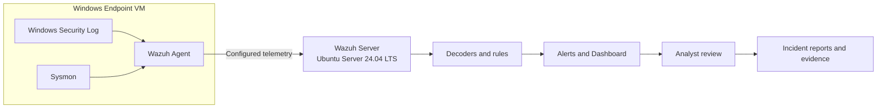

# Architecture

## Logical Flow

## Component Responsibilities

- **Windows Security Log:** records Windows security events, including failed logons when the relevant auditing is enabled.
- **Sysmon:** adds detailed telemetry such as process creation. Sysmon events must be configured for collection by the Wazuh agent.
- **Wazuh Agent:** forwards configured event data from Windows to the Wazuh server.
- **Wazuh Server:** analyses received events using configured decoders and rules.
- **Dashboard:** helps the analyst search and review alerts.
- **Reports:** document test method, observed result, and supporting evidence.

## Network Notes

Use the ports and enrollment procedure appropriate to the installed Wazuh version and chosen deployment method. The project plan expects agent communication on TCP/UDP 1514 as applicable to configuration and enrollment on TCP 1515; verify the actual protocol and listener configuration in the lab. Do not publish real internal IP addresses.
